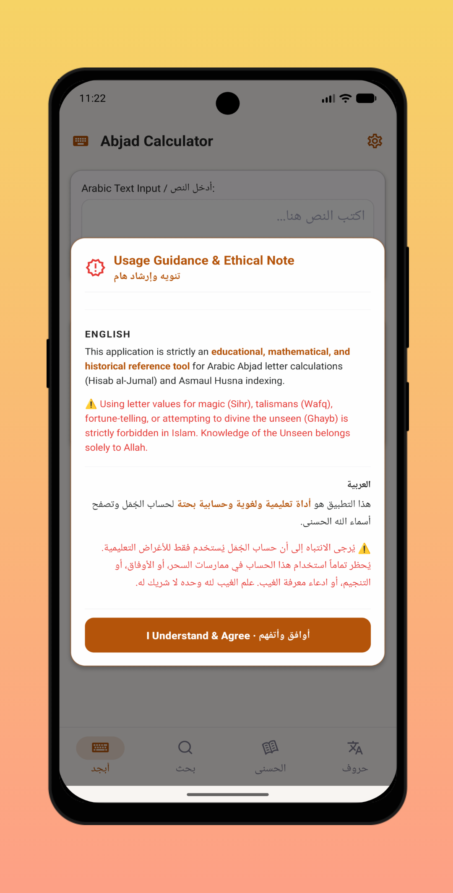
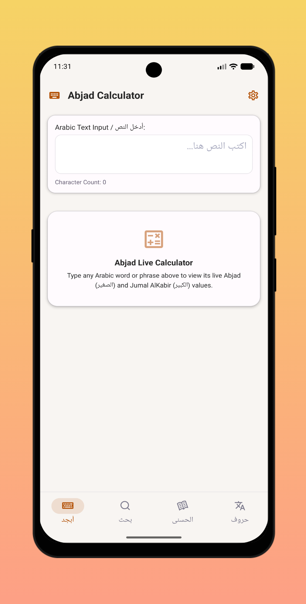
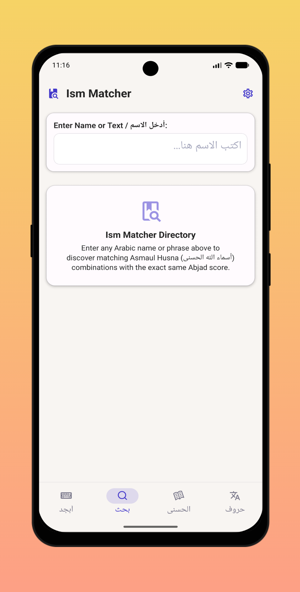
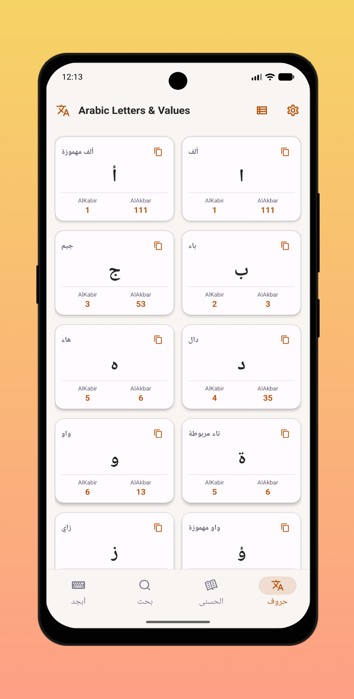
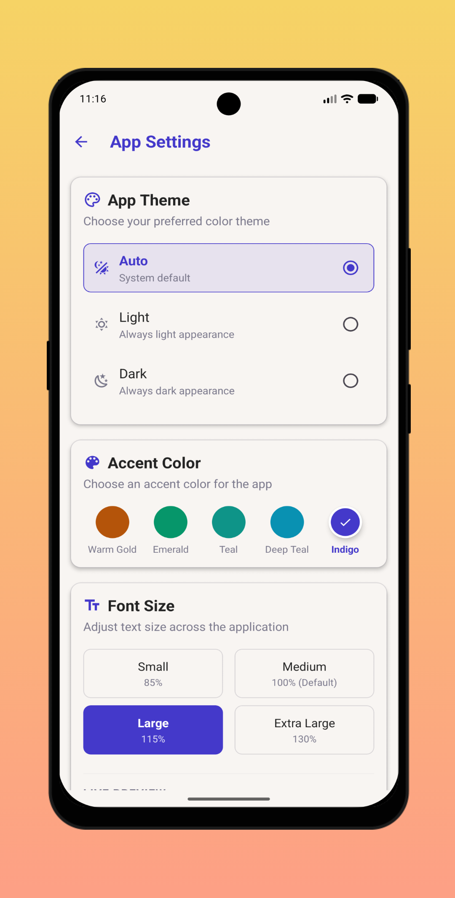

# 🧮📖 Abjadify: Your Ultimate Arabic Abjad Calculator & Reference 📖🧮

 

   
   
   
   
   

  

Unlock the numerical secrets of the Arabic language with **Abjadify**! This user-friendly app is an educational, mathematical, and historical reference tool for Arabic Abjad letter calculations (Hisab al-Jumal) and Asmaul Husna indexing, right at your fingertips.

## 🌟 Key Features of Abjadify 🌟

### 🧮 Live Abjad Calculator
- Type any Arabic word or phrase and instantly view its **Jumal AlKabir (الكبير)** and **Jumal AlAkbar (الأكبر)** values in real-time.
- Fast, responsive, and beautifully designed output cards with one-tap copy functionality.

### 🕌 Asmaul Husna Index
- Browse through the 99 Names of Allah (Asmaul Husna).
- View their meanings and their calculated Abjad values effortlessly.

### 📝 Arabic Letters Reference
- A complete reference table for all Arabic letters and their corresponding numeric values.
- Learn the foundations of Hisab al-Jumal directly from the app.

### 🚫 Completely Offline
- All calculations are performed on your device—no internet connection is required, giving you total privacy and speed.

### 🎨 Customizable Themes
- Choose between Light and Dark mode.
- Pick from beautiful primary accent colors (Warm Gold, Emerald, Teal, Deep Teal, Indigo) to personalize your experience.
- Adjust font sizes to your reading preference.

## 👥 Target Audience
Perfect for students, historians, linguists, and anyone interested in the mathematical richness of the Arabic language and Hisab al-Jumal.

## 🆓 Monetization & Accessibility
- **100% free to use**—no hidden charges, no premium features.
- Clean, modern, and minimalistic design for an intuitive user experience.

## ⚙️ Customization & Usability
Designed with focus and readability in mind. Easily switch tabs, customize your theme, copy values to your clipboard, and explore the numeric values of Arabic text instantly.

## ⚠️ Ethical Note
This application is strictly an **educational and linguistic tool**. Using letter values for magic (Sihr), talismans (Wafq), fortune-telling, or attempting to divine the unseen (Ghayb) is strictly forbidden in Islam. Knowledge of the Unseen belongs solely to Allah.

## 💬 Feedback & Support
Your voice matters! Share your thoughts and feedback through the Play Store comments. Your input helps us make **Abjadify** even better.

## 🧮 Why Choose Abjadify?
**Abjadify** is built with a strong focus on simplicity, accuracy, and user experience. Unlike complex or cluttered reference tools, Abjadify provides exactly what you need in an elegant and focused package.

**Discover the numerical depth of Arabic with Abjadify—download it today!**
